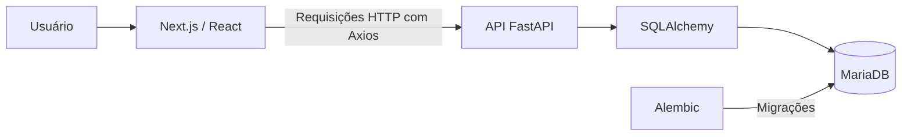

# 🍽️ Sistema de Gerenciamento de Restaurante

**Aplicação web Full Stack para gerenciamento de pedidos, mesas e cardápio**, desenvolvida com Python, FastAPI, Next.js e MariaDB.

Este projeto foi desenvolvido para exercitar a construção de uma aplicação que integra interface web, API REST e banco de dados relacional, reunindo operações comuns ao atendimento de um restaurante.

> **Status:** projeto de estudo e portfólio. A aplicação foi desenvolvida para execução local; não há deploy público informado neste repositório.

## 📋 Funcionalidades

### Pedidos
- Criar pedidos vinculados a uma mesa, com itens do cardápio e quantidades.
- Consultar a lista de pedidos e buscar pedidos por identificador.
- Atualizar e excluir pedidos.
- Calcular o valor total de um pedido a partir dos itens e quantidades.

### Mesas
- Criar e listar mesas.
- Consultar o estado das mesas e os pedidos relacionados.
- Fechar a conta de uma mesa e liberar a mesa no fluxo de atendimento.

### Cardápio
- Listar itens disponíveis.
- Cadastrar e excluir itens do cardápio via API.

## 🛠️ Tecnologias

| Camada | Tecnologias |
| --- | --- |
| Backend | Python, FastAPI, Pydantic, SQLAlchemy |
| Banco de dados | MariaDB, PyMySQL |
| Migrações | Alembic |
| Frontend | Next.js 15, React 19, TypeScript, Tailwind CSS |
| Integração HTTP | Axios |
| Documentação interativa | Swagger UI / OpenAPI (FastAPI) |

## 🖥️ Interface da aplicação

As imagens abaixo são capturas da interface disponibilizadas na documentação do frontend deste repositório.

### Página inicial


### Criação de pedidos


### Listagem e gerenciamento de pedidos


### Busca de pedidos


### Gerenciamento de mesas


### Cardápio


## 🏗️ Arquitetura



A interface consome a API FastAPI. O backend organiza as rotas por domínio (`orders`, `tables` e `menu`) e utiliza SQLAlchemy para acessar os dados armazenados no MariaDB.

### Estrutura principal

```text
gerencia_restaurante/
├── backend/
│   ├── api.py             # Inicialização da API e registro das rotas
│   ├── orders/            # Operações relacionadas a pedidos
│   ├── tables/            # Operações relacionadas a mesas
│   ├── menu/              # Operações relacionadas ao cardápio
│   ├── Shared/            # Modelos, conexão com o banco e funções compartilhadas
│   ├── alembic/           # Migrações de banco de dados
│   ├── alembic.ini
│   ├── requirements.txt
│   └── README.md
├── frontend/              # Aplicação Next.js
│   ├── package.json
│   └── README.md
└── README.md
```

## 🚀 Executando localmente

### Pré-requisitos

- Git;
- Python e `pip`;
- MariaDB instalado e em execução;
- Node.js e npm.

### 1. Clonar o repositório

```bash
git clone https://github.com/Ailesson/gerencia_restaurante.git
cd gerencia_restaurante
```

### 2. Configurar o banco de dados

Acesse o MariaDB com uma conta administrativa:

```bash
mysql -u root -p
```

Execute as instruções SQL (substitua a senha de exemplo por uma senha forte):

```sql
CREATE DATABASE gerencia_restaurante;
CREATE USER 'restaurante_user'@'localhost' IDENTIFIED BY 'SUA_SENHA_FORTE';
GRANT ALL PRIVILEGES ON gerencia_restaurante.* TO 'restaurante_user'@'localhost';
FLUSH PRIVILEGES;
```

### 3. Configurar o backend

Entre na pasta do backend e crie um ambiente virtual:

```bash
cd backend
python -m venv .venv
```

Ative o ambiente:

**Windows (PowerShell):**

```powershell
.\.venv\Scripts\Activate.ps1
```

**Linux/macOS:**

```bash
source .venv/bin/activate
```

Instale as dependências:

```bash
python -m pip install -r requirements.txt
```

Crie o arquivo `backend/.env` com os dados da sua instância MariaDB:

```dotenv
DATABASE_USER=restaurante_user
DATABASE_HOST=localhost
DATABASE_PASSWORD=SUA_SENHA_FORTE
DATABASE_NAME=gerencia_restaurante
DATABASE_PORT=3306
```

> **Atenção:** não publique o `.env` no GitHub. O código atual do Alembic também utiliza a URL definida em `backend/alembic.ini`; ajuste essa conexão no seu ambiente local antes de executar as migrações, sem enviar credenciais reais ao repositório. Uma melhoria futura recomendada é configurar o Alembic para ler a conexão diretamente das variáveis de ambiente.

Ainda dentro de `backend/`, aplique as migrações:

```bash
alembic upgrade head
```

Inicie a API:

```bash
python api.py
```

A documentação interativa estará disponível em **http://127.0.0.1:8002/docs**.

> O backend possui uma rotina de carga inicial que adiciona itens de exemplo ao cardápio e mesas quando não encontra registros correspondentes.

### 4. Executar o frontend

Abra **outro terminal** na raiz do repositório e execute:

```bash
cd frontend
npm install
npm run dev
```

Acesse **http://localhost:3000** para visualizar a aplicação.

Mantenha o backend e o frontend em execução ao mesmo tempo para utilizar os recursos integrados. Se necessário, confira se o endereço da API configurado no frontend corresponde à porta `8002`.

## 📚 API REST

O backend define rotas agrupadas pelos seguintes prefixos:

| Recurso | Operações disponibilizadas no código |
| --- | --- |
| `/orders` | Listar, criar, buscar, atualizar e excluir pedidos |
| `/tables` | Criar, listar, fechar conta e excluir mesas |
| `/menu` | Listar, cadastrar e excluir itens do cardápio |

Para consultar os caminhos, parâmetros e schemas gerados pelo FastAPI, utilize **http://127.0.0.1:8002/docs** com o servidor em execução.

### Exemplo de corpo para cadastro de pedido

```json
{
  "table_id": 1,
  "order_item": [1, 2],
  "quantity_item": [2, 1]
}
```

Os valores dos identificadores devem corresponder a mesas e itens existentes no banco de dados. As listas `order_item` e `quantity_item` representam, respectivamente, os itens solicitados e suas quantidades.

## 📌 Possíveis evoluções

- Ampliar a validação e os testes automatizados dos endpoints.
- Centralizar a configuração do banco e do Alembic em variáveis de ambiente.
- Revisar o tratamento de erros e as operações transacionais de pedidos e mesas.
- Adicionar autenticação e autorização para as operações administrativas.
- Automatizar verificações com GitHub Actions.
- Preparar uma versão de demonstração com deploy e dados fictícios.

Esses itens são **melhorias propostas**, e não funcionalidades declaradas como prontas.

## 👨‍💻 Autor

**Ailesson** — [GitHub](https://github.com/Ailesson) · [LinkedIn](https://www.linkedin.com/in/ailesson/)
