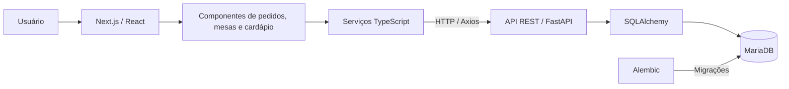
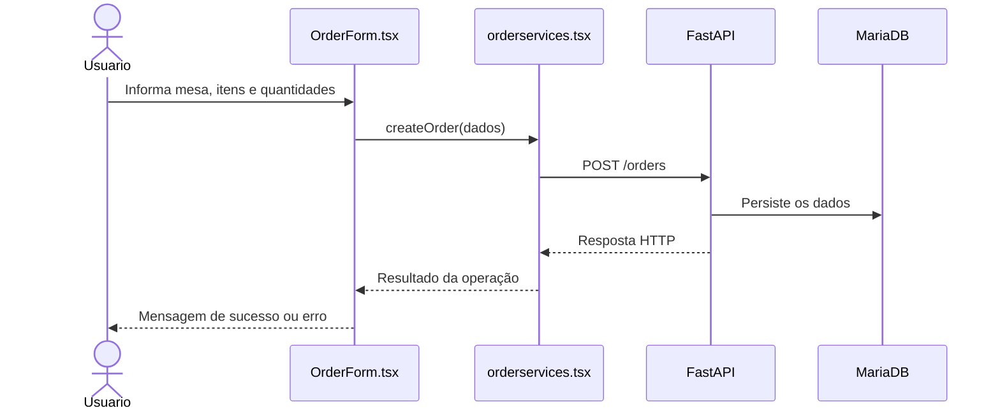

# 🍽️ Sistema de Gerenciamento de Restaurante

**Aplicação web Full Stack para gerenciamento de pedidos, mesas e cardápio**, desenvolvida com Python, FastAPI, Next.js e MariaDB.

Este projeto foi desenvolvido para exercitar a construção de uma aplicação que integra interface web, API REST e banco de dados relacional, reunindo operações comuns ao atendimento de um restaurante.

> **Status:** projeto de estudo e portfólio. A aplicação foi desenvolvida para execução local; não há deploy público informado neste repositório.

## 📋 Funcionalidades

### Pedidos
- Criar pedidos vinculados a uma mesa, com itens do cardápio e quantidades.
- Consultar a lista de pedidos e buscar pedidos por identificador.
- Atualizar e excluir pedidos.
- Calcular o valor total de um pedido a partir dos itens e quantidades.

### Mesas
- Criar e listar mesas.
- Consultar o estado das mesas e os pedidos relacionados.
- Fechar a conta de uma mesa e liberar a mesa no fluxo de atendimento.

### Cardápio
- Listar itens disponíveis.
- Cadastrar e excluir itens do cardápio via API.

## 🛠️ Tecnologias

| Camada | Tecnologias |
| --- | --- |
| Backend | Python, FastAPI, Pydantic, SQLAlchemy |
| Banco de dados | MariaDB, PyMySQL |
| Migrações | Alembic |
| Frontend | Next.js 15, React 19, TypeScript, Tailwind CSS |
| Integração HTTP | Axios |
| Documentação interativa | Swagger UI / OpenAPI (FastAPI) |

## 🖥️ Interface da aplicação

As imagens abaixo são capturas da interface disponibilizadas na documentação do frontend deste repositório.

### Página inicial


### Criação de pedidos


### Listagem e gerenciamento de pedidos


### Busca de pedidos


### Gerenciamento de mesas


### Cardápio


## 🏗️ Arquitetura da aplicação



O sistema foi dividido em **frontend e backend independentes**. A interface utiliza componentes React que chamam funções da camada de serviços; esses serviços se comunicam por HTTP com a API FastAPI. O backend concentra as operações relacionadas a pedidos, mesas e cardápio e acessa o MariaDB por meio do SQLAlchemy.

### Estrutura principal do repositório

```text
gerencia_restaurante/
├── backend/
│   ├── api.py                  # Inicialização da API
│   ├── orders/                 # Domínio de pedidos
│   ├── tables/                 # Domínio de mesas
│   ├── menu/                   # Domínio de cardápio
│   ├── Shared/                 # Código compartilhado e banco de dados
│   ├── alembic/                # Migrações
│   ├── alembic.ini
│   ├── requirements.txt
│   └── README.md
│
├── frontend/
│   ├── src/
│   │   └── app/
│   │       ├── components/
│   │       │   ├── AddTable.tsx
│   │       │   ├── GetOrder.tsx
│   │       │   ├── MenuList.tsx
│   │       │   ├── OrderForm.tsx
│   │       │   ├── OrderList.tsx
│   │       │   └── TableList.tsx
│   │       ├── services/
│   │       │   ├── api.tsx
│   │       │   ├── menuservices.tsx
│   │       │   ├── orderservices.tsx
│   │       │   └── tableservice.tsx
│   │       ├── globals.css
│   │       ├── layout.tsx
│   │       └── page.tsx
│   ├── next.config.ts
│   ├── tsconfig.json
│   ├── package.json
│   └── README.md
│
└── README.md
```

*A árvore apresenta os arquivos e diretórios principais confirmados no repositório; não é uma listagem exaustiva de arquivos de configuração ou recursos estáticos.*

## 🖥️ Estrutura e funcionamento do frontend

O frontend foi construído com **Next.js 15, React 19, TypeScript, Tailwind CSS 4 e Axios**. A implementação utiliza o **App Router do Next.js**, com a página principal em `src/app/page.tsx`.

Em vez de separar cada funcionalidade em páginas diferentes, o sistema reúne os módulos de pedidos, mesas e cardápio **na mesma tela**, com distribuição responsiva em colunas. Essa composição é feita diretamente no `page.tsx`.

### Componentes React (`src/app/components/`)

| Componente | Responsabilidade |
| --- | --- |
| `OrderForm.tsx` | Formulário de criação de pedidos: seleciona a mesa, permite adicionar/remover itens e enviar quantidades para a API. |
| `OrderList.tsx` | Exibe pedidos cadastrados, seus itens, mesa, data e valor total; oferece ações de atualização e exclusão. |
| `GetOrder.tsx` | Busca um pedido por ID e apresenta seus detalhes ou uma mensagem de erro. |
| `MenuList.tsx` | Consulta e apresenta os itens do cardápio com identificador, nome e preço. |
| `AddTable.tsx` | Cria uma nova mesa pela API e informa o identificador retornado. |
| `TableList.tsx` | Lista mesas, status, pedidos associados e totais; apresenta ação para fechamento de mesa. |

Os componentes usam **estado local do React (`useState`)** para armazenar dados, indicar carregamento e exibir mensagens. Alguns utilizam `useEffect` para buscar dados da API quando são montados. A interação para inserir ou alterar itens de pedidos atualmente também utiliza caixas de diálogo nativas do navegador (`prompt`, `confirm` e `alert`).

### Serviços de integração (`src/app/services/`)

A camada de serviços concentra o acesso à API, evitando espalhar chamadas HTTP diretamente pelos componentes.

| Arquivo | Funções e responsabilidades |
| --- | --- |
| `api.tsx` | Cria uma instância compartilhada do Axios, configurando a URL base do backend. |
| `orderservices.tsx` | Define tipos TypeScript e funções para listar, criar, buscar, atualizar e excluir pedidos. |
| `tableservice.tsx` | Define tipos TypeScript e funções para listar, criar e fechar mesas. |
| `menuservices.tsx` | Define os tipos do cardápio e a função de consulta dos itens. |

A URL base **atualmente está fixa** em `frontend/src/app/services/api.tsx`:

```tsx
import axios from "axios";

const api = axios.create({
  baseURL: "http://127.0.0.1:8002",
});

export default api;
```

Para executar localmente, a API precisa estar acessível nessa porta. Como melhoria futura, a URL poderá ser lida de uma variável de ambiente como `NEXT_PUBLIC_API_URL`.

### Página, layout e estilos (`src/app/`)

- **`page.tsx`**: componente `Home`, que reúne `GetOrder`, `MenuList`, `OrderForm`, `AddTable`, `TableList` e `OrderList`, organizados em seções responsivas.
- **`layout.tsx`**: layout raiz do Next.js, com definição das fontes e importação dos estilos globais.
- **`globals.css`**: estilos globais e configuração do Tailwind CSS; os componentes também utilizam classes utilitárias para espaçamento, cores, tipografia e responsividade.

### Fluxo de uma operação



O frontend também possui **tipos/interfaces TypeScript** para contratos de pedidos, itens, mesas e cardápio. Os valores monetários recebidos pela interface são exibidos em reais por meio da conversão de centavos (`valor / 100`).

> **Escopo atual:** a interface documentada contempla gerenciamento de pedidos e mesas e consulta do cardápio. O cadastro e a exclusão de itens do cardápio são recursos presentes na API, mas não foram identificados como formulários próprios nos componentes atuais do frontend.

## 🚀 Executando localmente

### Pré-requisitos

- Git;
- Python e `pip`;
- MariaDB instalado e em execução;
- Node.js e npm.

### 1. Clonar o repositório

```bash
git clone https://github.com/Ailesson/gerencia_restaurante.git
cd gerencia_restaurante
```

### 2. Configurar o banco de dados

Acesse o MariaDB com uma conta administrativa:

```bash
mysql -u root -p
```

Execute as instruções SQL (substitua a senha de exemplo por uma senha forte):

```sql
CREATE DATABASE gerencia_restaurante;
CREATE USER 'restaurante_user'@'localhost' IDENTIFIED BY 'SUA_SENHA_FORTE';
GRANT ALL PRIVILEGES ON gerencia_restaurante.* TO 'restaurante_user'@'localhost';
FLUSH PRIVILEGES;
```

### 3. Configurar o backend

Entre na pasta do backend e crie um ambiente virtual:

```bash
cd backend
python -m venv .venv
```

Ative o ambiente:

**Windows (PowerShell):**

```powershell
.\.venv\Scripts\Activate.ps1
```

**Linux/macOS:**

```bash
source .venv/bin/activate
```

Instale as dependências:

```bash
python -m pip install -r requirements.txt
```

Crie o arquivo `backend/.env` com os dados da sua instância MariaDB:

```dotenv
DATABASE_USER=restaurante_user
DATABASE_HOST=localhost
DATABASE_PASSWORD=SUA_SENHA_FORTE
DATABASE_NAME=gerencia_restaurante
DATABASE_PORT=3306
```

> **Atenção:** não publique o `.env` no GitHub. O código atual do Alembic também utiliza a URL definida em `backend/alembic.ini`; ajuste essa conexão no seu ambiente local antes de executar as migrações, sem enviar credenciais reais ao repositório. Uma melhoria futura recomendada é configurar o Alembic para ler a conexão diretamente das variáveis de ambiente.

Ainda dentro de `backend/`, aplique as migrações:

```bash
alembic upgrade head
```

Inicie a API:

```bash
python api.py
```

A documentação interativa estará disponível em **http://127.0.0.1:8002/docs**.

> O backend possui uma rotina de carga inicial que adiciona itens de exemplo ao cardápio e mesas quando não encontra registros correspondentes.

### 4. Executar o frontend

Abra **outro terminal** na raiz do repositório e execute:

```bash
cd frontend
npm install
npm run dev
```

Acesse **http://localhost:3000** para visualizar a aplicação.

Mantenha o backend e o frontend em execução ao mesmo tempo para utilizar os recursos integrados. Se necessário, confira se o endereço da API configurado no frontend corresponde à porta `8002`.

## 📚 API REST

O backend define rotas agrupadas pelos seguintes prefixos:

| Recurso | Operações disponibilizadas no código |
| --- | --- |
| `/orders` | Listar, criar, buscar, atualizar e excluir pedidos |
| `/tables` | Criar, listar, fechar conta e excluir mesas |
| `/menu` | Listar, cadastrar e excluir itens do cardápio |

Para consultar os caminhos, parâmetros e schemas gerados pelo FastAPI, utilize **http://127.0.0.1:8002/docs** com o servidor em execução.

### Exemplo de corpo para cadastro de pedido

```json
{
  "table_id": 1,
  "order_item": [1, 2],
  "quantity_item": [2, 1]
}
```

Os valores dos identificadores devem corresponder a mesas e itens existentes no banco de dados. As listas `order_item` e `quantity_item` representam, respectivamente, os itens solicitados e suas quantidades.

## 📌 Possíveis evoluções

- Ampliar a validação e os testes automatizados dos endpoints.
- Centralizar a configuração do banco e do Alembic em variáveis de ambiente.
- Revisar o tratamento de erros e as operações transacionais de pedidos e mesas.
- Adicionar autenticação e autorização para as operações administrativas.
- Automatizar verificações com GitHub Actions.
- Preparar uma versão de demonstração com deploy e dados fictícios.

Esses itens são **melhorias propostas**, e não funcionalidades declaradas como prontas.

## 👨‍💻 Autor

**Ailesson** — [GitHub](https://github.com/Ailesson) · [LinkedIn](https://www.linkedin.com/in/ailesson/)
